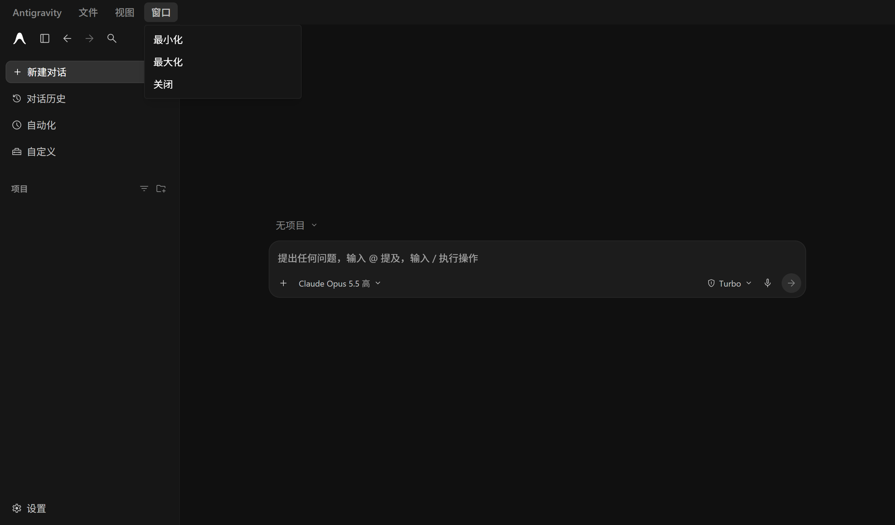

# Antigravity 简体中文汉化补丁

为 Google **Antigravity** 桌面应用（以智能体为核心的新版，Windows）提供简体中文界面。

- **每天检查 Antigravity 更新**：维护端每天自动检查 Antigravity 是否发布新版本，发现更新后同步更新汉化补丁。
- **用户端全自动**：补丁发布新版本、或 Antigravity 自身更新导致汉化失效后，都会在后台自动重新汉化，无需手动操作。



## 安装

**方式一：一行命令（推荐）**：在 PowerShell 中运行：

```powershell
irm https://raw.githubusercontent.com/RainyMarks/antigravity-zh-cn/main/install.ps1 | iex
```

无法访问 GitHub 时可改用 jsDelivr 镜像：

```powershell
irm https://cdn.jsdelivr.net/gh/RainyMarks/antigravity-zh-cn@main/install.ps1 | iex
```

**方式二：下载压缩包**：从 [Releases](https://github.com/RainyMarks/antigravity-zh-cn/releases/latest) 下载 zip，解压后双击 `安装汉化.cmd`。

安装过程中如果 Antigravity 正在运行，脚本会询问是否帮你关闭（正在运行的智能体任务会中断）。安装完成后重新打开 Antigravity 即可。

可选参数（两种方式都支持，例如 `安装汉化.cmd -Lang`）：

| 参数 | 作用 |
|---|---|
| `-Lang` | 同时把 Chromium 语言设为 zh-CN（日期格式、原生输入校验提示等变为中文） |
| `-NoAutoUpdate` | 不开启自动更新 |
| `-AppDir "D:\Apps\Antigravity"` | Antigravity 不在默认位置时指定安装目录 |

## 自动更新

补丁安装在 `%LOCALAPPDATA%\antigravity-zh-cn`，并创建一个计划任务 `AntigravityZhCN`（登录时及每小时运行一次，后台静默，不弹窗）：

1. 从 GitHub Releases 检查补丁新版本（失败时改用 jsDelivr 镜像），下载后逐文件校验 SHA-256；
2. 如果补丁有新版本，或者 Antigravity 更新后汉化丢失，就在 **Antigravity 未运行时**自动重新打补丁。

此外，汉化后的 Antigravity **退出时**会立即触发一次上述检查（会等 Antigravity 自身的更新安装程序结束后再处理），因此通常下次打开时就已经是最新汉化。

> Antigravity 正在运行时无法修改它的文件，所以新汉化总是在你退出 Antigravity 后才生效。
> 如果 Antigravity 通过「重启以更新」升级后立即重新打开（此时为英文界面），后台会一直等待，你一关闭 Antigravity 就自动重新汉化。

常用命令：

```powershell
$agzh = "$env:LOCALAPPDATA\antigravity-zh-cn\agzh.ps1"
powershell -ExecutionPolicy Bypass -File $agzh -Action Status   # 查看状态
powershell -ExecutionPolicy Bypass -File $agzh -Action Update   # 立即检查更新
```

日志位于 `%LOCALAPPDATA%\antigravity-zh-cn\logs\`。

## 卸载

双击 `%LOCALAPPDATA%\antigravity-zh-cn\卸载汉化.cmd`（或 zip 包里的同名文件，或运行 `agzh.ps1 -Action Uninstall`）：还原英文原版 `app.asar`、删除计划任务，并可选择删除补丁文件。

## 汉化范围

| 部分 | 方式 |
|---|---|
| 主界面：侧边栏、对话、设置、自定义、市场、插件/技能/MCP、权限、Git、浏览器面板、各类弹窗/提示/占位符 | 运行时翻译，词典约 4300 条（含 350+ 条带参数模板） |
| 相对时间（2mo、3d、5 minutes ago…） | 正则规则 |
| 原生右键菜单、系统通知、页面内 confirm/alert 对话框 | preload 中拦截翻译 |
| 托盘菜单、退出确认、检查更新、打开文件夹对话框、WSL 提示、首次启动向导 | 直接替换外壳源码 |

**不会翻译**：智能体回复正文（Markdown 区域）、代码块、编辑器、终端、输入框中的内容、项目/对话名称、模型和产品名称（Gemini、Claude、Turbo、MCP 等）。

## 原理

- 只修改 `resources\app.asar`（Electron 外壳，约 4MB），**不改动** `language_server.exe`。首次修改前会备份为 `app.asar.zh-cn-backup`，卸载时原样还原。
- 主界面由 language_server 在本地提供，是编译后的 React 应用。补丁在 `preload.js` 末尾注入翻译器，用 MutationObserver 监听 DOM，
  只替换**整段文字与词典精确匹配**的文本节点，以及 `title` / `placeholder` / `aria-label` 等属性，避免误改你的内容。
- 翻译器运行在 preload 的隔离环境（isolated world）中，不修改页面脚本，不影响功能逻辑。
- 打补丁借用 `Antigravity.exe` 自带的 Node 运行时（`ELECTRON_RUN_AS_NODE`），无需安装 Node.js。下载由 PowerShell 完成，会使用系统代理设置。

## 常见问题

**某些地方还是英文？** 部分文字（例如额度、套餐说明）由服务器下发，不在本地代码里，需要逐步补充。欢迎在 [Issues](https://github.com/RainyMarks/antigravity-zh-cn/issues) 中反馈截图或原文。

**Antigravity 更新后变回英文了？** 退出 Antigravity 即可，后台会自动重新汉化；也可以运行 `agzh.ps1 -Action Update`。

**安装时提示“自动更新任务无法访问补丁文件”？** 请在自己打开的 PowerShell 窗口中运行安装命令，不要在其他应用（例如 AI 助手桌面版）内置的终端里运行。部分打包应用（MSIX）会把写入 `%LOCALAPPDATA%` 的新文件重定向到它自己的私有目录，计划任务和 Antigravity 都无法访问这些文件，自动更新会因此失效。

**想修改某条译文？** 编辑 `%LOCALAPPDATA%\antigravity-zh-cn\zh-cn\dict.json` 后运行一次 `安装汉化.cmd` 即可生效；注意下次自动更新会覆盖本地修改，欢迎直接提交 PR。

## 参与贡献

翻译、补漏和适配新版本的流程见 [docs/MAINTAINING.md](docs/MAINTAINING.md)，译文规范见 [docs/TRANSLATION_GUIDE.md](docs/TRANSLATION_GUIDE.md)。

## 免责声明

本项目为非官方社区项目，与 Google 无关。Antigravity 是 Google 的产品，本仓库不包含其任何代码，仅在你的电脑上修改已安装的应用文件。使用风险自负。

## 许可证

[MIT](LICENSE)
